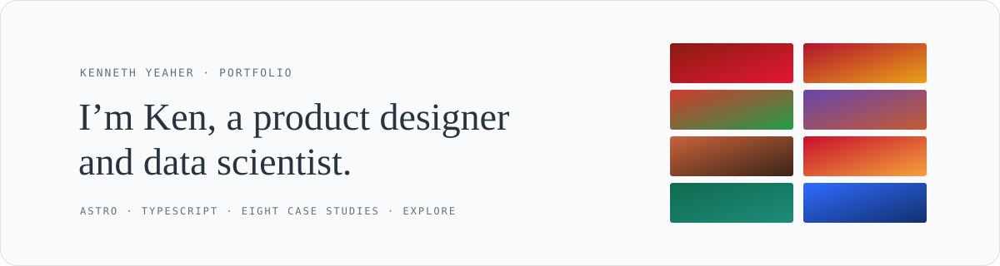
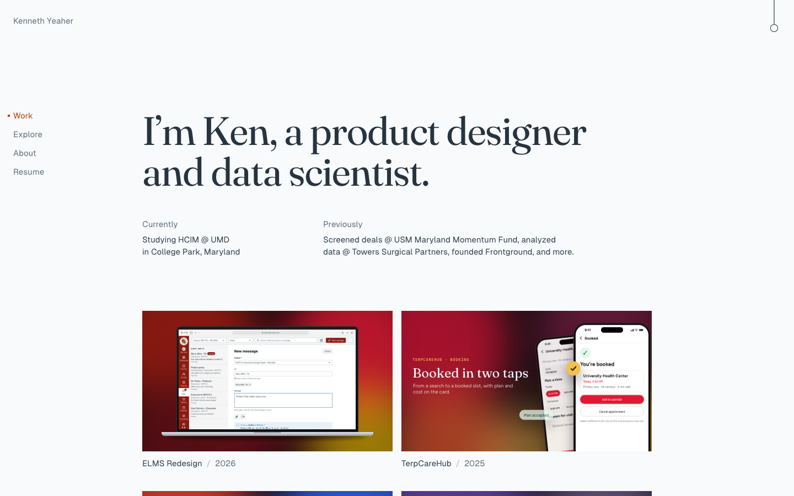
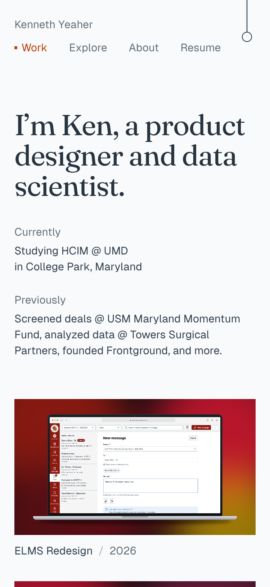

<p align="center">
  
</p>

<p align="center">
  <strong>An editorial portfolio for Kenneth Yeaher’s product, data, venture, and human-computer interaction work.</strong><br>
  The site is built with Astro and TypeScript and uses one verified content model for the Work page and eight case studies.
</p>

<p align="center">
  
  
  <a href="https://kennethyeaher.github.io/"></a>
  <a href="https://github.com/kennethyeaher/kennethyeaher.github.io/actions/workflows/deploy.yml"></a>
</p>

<p align="center">
  <a href="https://kennethyeaher.github.io/"><strong>Open the portfolio ↗</strong></a> &nbsp; · &nbsp;
  <a href="#how-the-portfolio-fits-together">How it fits together</a> &nbsp; · &nbsp;
  <a href="#verification">Verification</a> &nbsp; · &nbsp;
  <a href="#editing-content">Editing content</a>
</p>

---



<details>
<summary><strong>See the mobile layout</strong></summary>
<br>
<p align="center"></p>
</details>

<sub>The current home page, captured from a local build on November 5, 2026.</sub>

## My contribution

I brought my project narratives and source artifacts into a shared content model, built the portfolio pages and navigation, and added content and asset checks. Individual case studies retain their own research and collaboration context.

## How the portfolio fits together

The Work page provides a quick entry into the projects. Each case study then connects the problem, my role, source artifacts, and limitations. The About page supplies personal context, and the résumé remains available as a direct PDF download.

For a technical review, start with the shared content model in `src/data/portfolio.mjs`, then follow it into the page components. Separating content from presentation keeps project descriptions consistent across cards and detailed pages.

## Local preview

The site needs Node 22.12 or later.

```bash
npm ci
npm run dev
```

The default local address is `http://127.0.0.1:4321/` when the preview is started with the host and port used during QA.

## Verification

```bash
npm test
npm run check
npm run build
```

- `npm test` checks the content model, navigation shell, Work and About pages, case-study routes, factual guardrails, media references, and résumé integrity.
- `npm run check` runs Astro and TypeScript diagnostics.
- `npm run build` generates eight project social cards, then produces the static site in `dist/`.

Home cards show a device mockup or a short motion cover over a gradient drawn from each project's palette, and the gradient drifts only while on screen. Case-study heroes show existing interface screens or research artifacts with a playback control. On mouse and trackpad, a dot cursor replaces the native one. Theme choice follows the operating system until a visitor pulls the cord at the top right to choose light or dark. Pages fade through on navigation. Page transitions, reveals, and cover motion respect reduced motion. Without JavaScript, the cursor stays native, the cord is hidden, and navigation and content remain available.

## Current routes

| Route | Purpose |
|---|---|
| `/` | Work page with the headline, the Currently and Previously lines, and eight featured projects |
| `/explore` | Reel of personal and school work, filtered by category |
| `/explore/[id]` | Detail page for each Explore piece |
| `/about` | HCI-focused biography, experience, education, interests, and photo chapters |
| `/work/[slug]` | Reusable evidence-led case-study page |
| `/resume/kyresume.pdf` | Byte-for-byte copy of the supplied master résumé PDF |

Former `/projects`, `/contact`, and `/education` URLs are retained as redirects so stale duplicate pages are not published.

## Editing content

The current public content lives in three files under `src/data/`:

- [`portfolio.mjs`](src/data/portfolio.mjs) controls header identity and contact links, the home page Currently and Previously lines, About writing, experience, and gallery entries, and project order;
- [`caseStudies.mjs`](src/data/caseStudies.mjs) controls project copy, metrics, media, and case-study chapters;
- [`explore.mjs`](src/data/explore.mjs) controls the Explore categories and items.

Add future user-supplied About photographs to the `aboutGallery` array only after placing the real files in `public/images/about/`. The page intentionally creates no empty photo placeholders.

Project visuals live under `public/images/work/` and `public/images/exhibits/`, and Explore visuals live under `public/images/explore/`. Every visible project image is a user-approved source artifact or a direct Figma export. Do not substitute CSS drawings, handcrafted SVGs, emoji, or generic placeholders for evidence.

## Structure

```text
src/
  components/       Shared navigation, cards, gallery, media, and case-study UI
  data/             Content files, led by portfolio.mjs, caseStudies.mjs, and explore.mjs
  layouts/Base.astro
  pages/
    index.astro
    about.astro
    explore/
    work/[slug].astro
  scripts/          site.ts and the browser scripts for each feature
  styles/global.css
public/
  images/work/
  images/exhibits/
  images/explore/
  resume/kyresume.pdf
scripts/            Build steps for covers, social cards, and sized images
tests/
```

## Published site

The portfolio is published at [kennethyeaher.github.io](https://kennethyeaher.github.io/). Pushes to `main` are verified and deployed automatically through GitHub Pages.

---

## Author

**Kenneth Yeaher**  
MS in Human Computer Interaction  
University of Maryland, College Park  
[](https://www.linkedin.com/in/kennethyeaher/)

`Astro` · `TypeScript` · `Portfolio Design`
